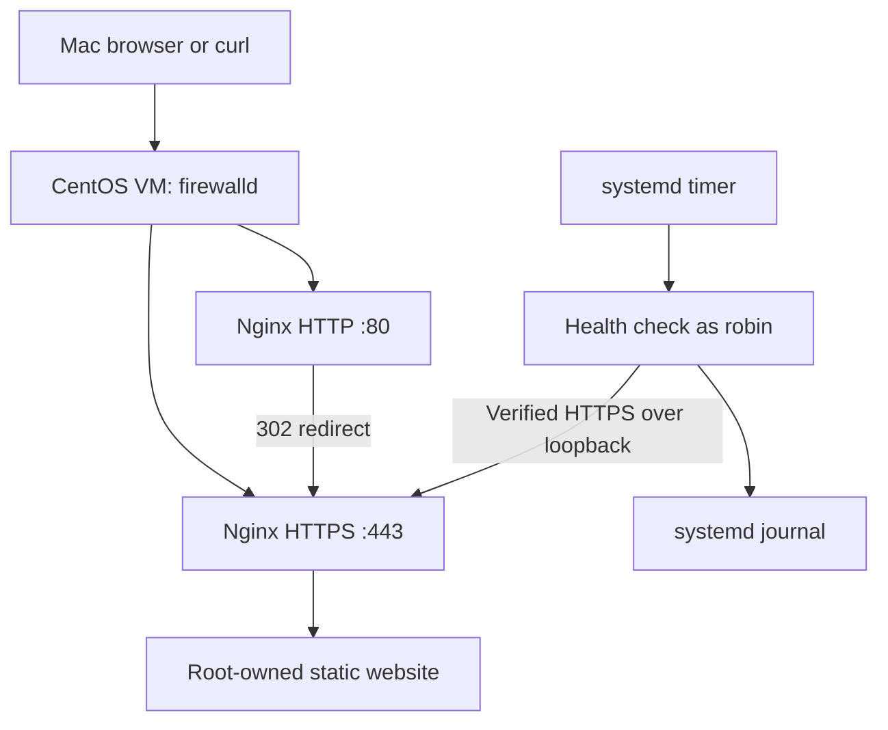

# Secure Linux Web Server

A hands-on infrastructure lab by Robin Miah: deploy and operate an
Nginx website on CentOS Stream 10 with HTTPS, SELinux enforcement,
firewall rules, scheduled health checks and tested configuration recovery.

This is a local learning and portfolio project, not a production deployment
or professional employment experience.

## Architecture



UTM hosts the ARM64 virtual machine on the Mac. The browser connects
through the VM network. Local health checks use loopback and do not
test access through the external network interface.

## Environment

- CentOS Stream 10, ARM64, running in UTM
- 4 virtual CPUs and approximately 5.5 GiB RAM
- Nginx 1.26.3 at implementation time
- firewalld with SELinux enforcing
- OpenSSL, chrony, curl and systemd
- Lab IPv4 address: `192.168.64.2`

Versions describe the tested environment, not a recommendation to pin
old packages. Use supported distribution updates.

## Implemented features

- Static website served from `/usr/share/nginx/html`.
- HTTP-to-HTTPS redirection using status 302.
- TLS 1.2 and TLS 1.3 enabled in the HTTPS configuration.
- Self-signed certificate with IP subject alternative names.
- Certificate-verified curl checks using an explicit trust file.
- Nginx version hidden from HTTP response headers.
- Root-owned website files readable but not writable by the nginx user.
- Nginx processes running in the SELinux `httpd_t` domain.
- Persistent HTTP and HTTPS firewall rules.
- Automatic Nginx startup after reboot.
- A health check running approximately every minute through systemd.
- Journal logging of successful and failed checks.
- Existing Nginx log rotation inspected and its configuration dry-run tested.
- Configuration backup and restoration tested.

## Repository layout

| Path | Purpose |
|---|---|
| `site/index.html` | Website source |
| `scripts/check-web.sh` | HTTPS availability check |
| `config/nginx/nginx.conf` | Main Nginx configuration |
| `config/nginx/conf.d/https.conf` | HTTPS server |
| `config/nginx/conf.d/security.conf` | Version-disclosure setting |
| `config/nginx/default.d/https-redirect.conf` | HTTP redirect |
| `config/systemd/web-health.service` | Restricted one-shot health-check service |
| `config/systemd/web-health.timer` | Periodic check schedule |
| `config/logrotate/nginx` | Distribution-provided rotation policy inspected in this lab |

Private keys, generated certificates and raw baseline files are excluded.

## Deployment notes

These are configuration snapshots from the tested VM, not a universal
one-command installer. Review them before applying them to another machine.

1. Install Nginx and the required utilities on CentOS Stream 10.
2. Confirm time synchronization before generating certificates.
3. Back up the existing Nginx configuration.
4. Deploy the page with root ownership and file mode 0644.
5. Restore the default SELinux labels for deployed files.
6. Generate a local certificate and protect its private key.
7. Install the reviewed Nginx configuration, validate it with `nginx -t`,
   and reload only after validation succeeds.
8. Enable Nginx at boot and permit HTTP/HTTPS in both runtime and permanent
   firewall configurations.
9. Install the health-check script at `/usr/local/bin/check-web`.
10. Install the systemd service and timer, reload systemd definitions,
    and enable `web-health.timer`.

### Values to adapt

- Replace `192.168.64.2` in the HTTPS server and HTTP redirect if needed.
- Regenerate the certificate with the actual address in its SAN extension.
- Keep `127.0.0.1` in the certificate SAN for the local health check.
- Replace `User=robin` with an appropriate unprivileged local account.
- Certificate path: `/etc/pki/nginx/secure-linux.crt`.
- Private-key path: `/etc/pki/nginx/private/secure-linux.key`.
- The private directory uses mode 0700; the root-owned key uses mode 0600.
- The check account must be able to read the public certificate.
- Do not copy private keys into this repository.

The HTTP redirect file is loaded by the HTTP server's `default.d` include.
The HTTPS server does not load that include, avoiding a redirect loop.

## Verification

Validate configuration:

```bash
sudo nginx -t
```

Verify the redirect and HTTPS response:

```bash
curl -IL --cacert /etc/pki/nginx/secure-linux.crt http://192.168.64.2/
```

Expected: HTTP 302 followed by HTTPS 200, with certificate verification enabled.

Run the health check:

```bash
/usr/local/bin/check-web
echo $?
```

Expected: HEALTHY and exit code 0.

Inspect scheduled checks:

```bash
systemctl list-timers --all web-health.timer
sudo journalctl -b -u web-health.service --no-pager
```

Check confinement:

```bash
getenforce
ps -eo user,pid,ppid,label,args | grep '[n]ginx'
```

Expected: Enforcing, a root-owned master, nginx-owned workers,
and the SELinux type `httpd_t`.

## Tests completed

| Test | Observed result |
|---|---|
| Access from the Mac | Project page loaded |
| HTTP redirection | 302 response with HTTPS destination |
| Local certificate verification | HTTPS 200 using `--cacert` |
| Website permissions | nginx could read but not modify the page or directory |
| Missing-page request | 404 correlated with access and error logs |
| Manual outage check | Exit 1 while Nginx stopped; exit 0 after restart |
| Scheduled outage check | Failure recorded, followed by automatic healthy checks after manual recovery |
| Invalid configuration | `nginx -t` rejected the injected unknown directive |
| Configuration restoration | Backup restored; validation and health check passed |
| Final reboot | Services, firewall rules, HTTPS and monitoring resumed |
| Log rotation | Enabled timer and successful debug inspection; no forced rotation performed |

## Troubleshooting and recovery

### Missing page

The access log recorded 404. The error log identified the missing file.
A 404 response did not mean the web server was stopped.

### Incorrect VM clock

Chrony reached time sources, but the system clock remained approximately
23.5 hours behind. A controlled `chronyc makestep` corrected the offset.
Follow-up checks confirmed synchronization and agreement with the RTC.
The original cause of the drift was not established.

### Invalid Nginx configuration

A deliberately invalid directive was detected before reload. The existing
service continued serving requests. The affected file was restored from
a verified backup, tested with `nginx -t`, and then reloaded.

Validate before every reload. Configuration backups under
`/var/backups/nginx` do not include the separate TLS key and certificate
directory or constitute a full-server backup.

## Security and operational limitations

- This VM is a private lab; public internet exposure was not tested.
- The certificate is self-signed, not publicly trusted. Browser access used
  a certificate exception; curl used an explicit certificate trust file.
- The lab certificate expires on 7 February 2027. Renewal is manual.
- The VM uses DHCP. An address change requires reviewing the certificate
  and redirect configuration.
- Hiding the Nginx version does not replace patching.
- Cockpit and SSH remain permitted as administration services.
  They have not undergone a complete administration-access hardening review.
- Monitoring checks the local HTTPS status and certificate validity.
  It does not verify page content, external reachability, disk usage,
  or provide advance certificate-expiry alerts.
- Failures are logged locally. No external notifications or automatic
  remediation are implemented.
- Daily log rotation retains up to ten rotated versions; it is not a
  hard limit on disk consumption.
- Reboot recovery and individual configuration restoration were tested;
  full VM backup restoration was not tested.
- Availability depends on the Mac and VM remaining running.

## What I learned

- Separate service, network, firewall and certificate-trust failures.
- Use logs to connect a symptom to its cause.
- Apply least-privilege file permissions and inspect SELinux confinement.
- Validate configuration before applying it.
- Make health checks return useful exit codes.
- Verify recovery and persistence rather than assuming configuration is enough.
